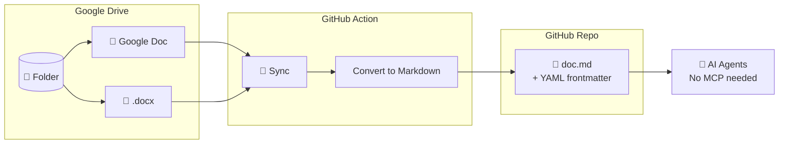

# Google Drive to GitHub Markdown Mirror

[](https://github.com/marketplace/actions/google-drive-to-github-sync)
[](https://github.com/sderosiaux/google-drive-to-github-sync/releases)
[](https://opensource.org/licenses/MIT)

Sync Google Docs from Drive folders to GitHub as Markdown files with YAML frontmatter.



## Features

- Converts Google Docs and `.docx` files to Markdown via Pandoc
- Incremental sync (only downloads changed files)
- Preserves folder structure with slugified names
- YAML frontmatter with metadata (title, drive_id, modified_time)
- Exclusion patterns for files and folders
- Shared Drive (Team Drive) support
- Dry-run mode to preview changes

## Quick Start (GitHub Action)

Add this workflow to any repo:

**`.github/workflows/sync.yml`**
```yaml
name: Sync Drive to GitHub

on:
  schedule:
    - cron: "0 */6 * * *"  # Every 6 hours
  workflow_dispatch:        # Manual trigger

permissions:
  contents: write

jobs:
  sync:
    runs-on: ubuntu-latest
    steps:
      - uses: actions/checkout@v4

      - uses: sderosiaux/google-drive-to-github-sync@main
        with:
          google_credentials: ${{ secrets.GOOGLE_SERVICE_ACCOUNT_JSON }}
          config: |
            sync:
              - drive_folder_id: "1qXYZ123abcDEF456"
                github_folder: "docs/product"
              - drive_folder_id: "9abcDEF789xyz"
                github_folder: "docs/security"
                exclude_folders:
                  - Archive
                  - "*backup*"
                exclude_files:
                  - "DRAFT*"
```

### Action Inputs

| Input | Required | Description |
|-------|----------|-------------|
| `google_credentials` | No | Service account JSON; omit to use Application Default Credentials (including WIF) |
| `config` | Yes | Inline YAML configuration |
| `commit` | No | Commit changes after sync (default: `true`) |
| `commit_message` | No | Custom commit message |

### Setting up the Secret

1. Go to your GitHub repo → Settings → Secrets and variables → Actions
2. Create a new secret named `GOOGLE_SERVICE_ACCOUNT_JSON`
3. Paste the entire contents of your service account JSON file

### Workload Identity Federation (no service account key)

Configure [Workload Identity Federation through a service account](https://github.com/google-github-actions/auth#workload-identity-federation-through-a-service-account), restricting access to your GitHub repository. Enable the Google Drive API and share the source folders with that service account. You do not need to create a JSON key.

Run `google-github-actions/auth` after checkout and omit `google_credentials`:

```yaml
permissions:
  contents: write
  id-token: write

jobs:
  sync:
    runs-on: ubuntu-latest
    steps:
      - uses: actions/checkout@v7
      - uses: google-github-actions/auth@v3
        with:
          project_id: ${{ vars.GCP_PROJECT_ID }}
          workload_identity_provider: ${{ vars.GCP_WORKLOAD_IDENTITY_PROVIDER }}
          service_account: ${{ vars.GCP_SERVICE_ACCOUNT }}
      - uses: sderosiaux/google-drive-to-github-sync@main
        with:
          config: |
            sync:
              - drive_folder_id: "YOUR_DRIVE_FOLDER_ID"
                github_folder: "docs"
```

The auth action creates a temporary credentials file and sets `GOOGLE_APPLICATION_CREDENTIALS`. The sync client loads it through Application Default Credentials with the `drive.readonly` scope. Keep the auth action's `create_credentials_file` and `export_environment_variables` settings enabled (the defaults).

Add `gha-creds-*.json` to the consuming repository's `.gitignore` and exclude it from uploaded artifacts. Automatic sync commits also exclude files with this name pattern.

## Local Usage (Testing)

For testing locally before setting up the GitHub Action.

### Prerequisites

- Python 3.10+
- [Pandoc](https://pandoc.org/installing.html)

### Installation

```bash
# Clone and install
git clone https://github.com/sderosiaux/google-drive-to-github-sync.git
cd google-drive-to-github-sync
pip install -e .
```

### Configuration

Create a `.drive-sync.yml` file:

```yaml
sync:
  - drive_folder_id: "1qXYZ123abcDEF456"
    github_folder: "docs"
```

### Commands

```bash
# Preview changes (dry-run)
drive-sync --dry-run --credentials-file ~/path/to/credentials.json

# Run sync
drive-sync --credentials-file ~/path/to/credentials.json -v

# Verify access to folders
drive-sync verify --credentials-file ~/path/to/credentials.json

# Create a new config file
drive-sync init
```

### Environment Variable

Instead of `--credentials-file`, you can use:

```bash
export GOOGLE_SERVICE_ACCOUNT_JSON="$(cat ~/path/to/credentials.json)"
drive-sync --dry-run
```

When no explicit JSON credentials are supplied, the CLI uses Application Default Credentials, including a WIF configuration file referenced by `GOOGLE_APPLICATION_CREDENTIALS`:

```bash
export GOOGLE_APPLICATION_CREDENTIALS="/path/to/wif-credentials.json"
drive-sync --dry-run
drive-sync verify
```

Credential precedence is `--credentials-file`, then `--credentials`, then a non-empty `GOOGLE_SERVICE_ACCOUNT_JSON`, then Application Default Credentials. Invalid explicit credentials fail instead of falling back to a different identity.

### CLI Options

| Option | Description |
|--------|-------------|
| `--config PATH` | Config file (default: `.drive-sync.yml`) |
| `--credentials-file PATH` | Path to service account JSON file |
| `--credentials JSON` | Service account JSON string |
| `--base-path PATH` | Output directory (default: current) |
| `--dry-run` | Preview changes without writing |
| `-v, --verbose` | Enable debug logging |
| `--commit` | Commit changes to git after sync |

## Google Service Account Setup

1. Go to [Google Cloud Console](https://console.cloud.google.com/)
2. Create a project (or select existing)
3. Enable the **Google Drive API**
4. Go to **IAM & Admin → Service Accounts**
5. Create a service account
6. Create a JSON key and download it
7. Share your Drive folder(s) with the service account email
   - **Contributor** access required (Viewer cannot export Google Docs)

### Finding Drive Folder IDs

Open the folder in Google Drive:
```
https://drive.google.com/drive/folders/1qXYZ123abcDEF456
                                        └─────────────────┘
                                         This is the folder ID
```

## Output Format

Each synced file becomes a Markdown file with YAML frontmatter:

```markdown
---
title: "My Document Title"
drive_id: "1abc123DEF456"
modified_time: "2024-01-15T10:30:00Z"
---

# Document content here...
```

## Why not just use MCP?

MCP (Model Context Protocol) allows AI assistants to access Google Drive directly. So why sync to GitHub?

- **Direct file access**: Files are in your repo, instantly available to any tool, script, or AI
- **Searchable**: Full-text search with `grep`, GitHub search, or your IDE
- **Diffable**: See what changed between syncs with `git diff`
- **Versionable**: Full history of every document change
- **Offline**: Works without API calls or authentication
- **CI/CD friendly**: Build pipelines can process the markdown directly
- **No runtime dependency**: No need for MCP server running

MCP is great for interactive queries. This tool is for having a persistent, versioned mirror.

## Development

```bash
pip install -e ".[dev]"
pytest
```

## License

MIT
